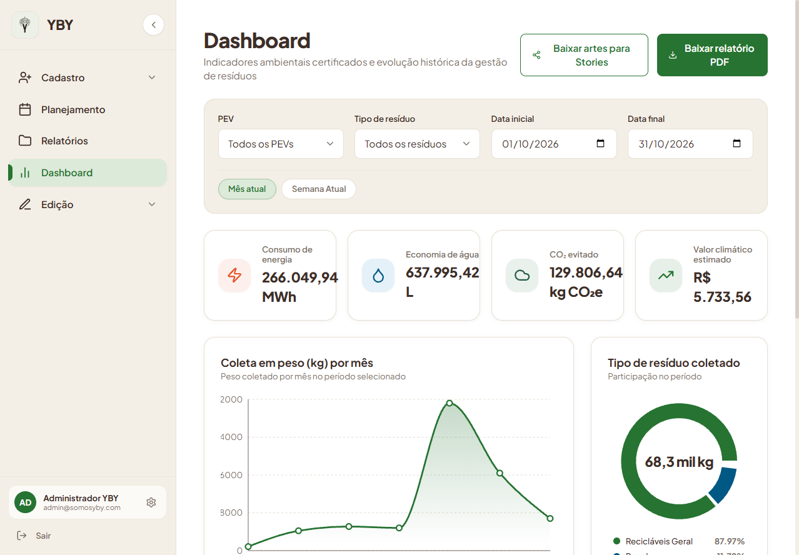
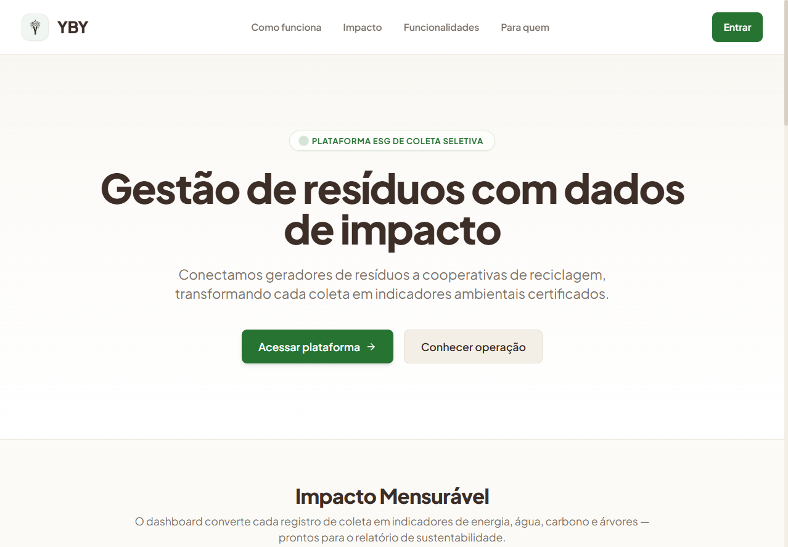
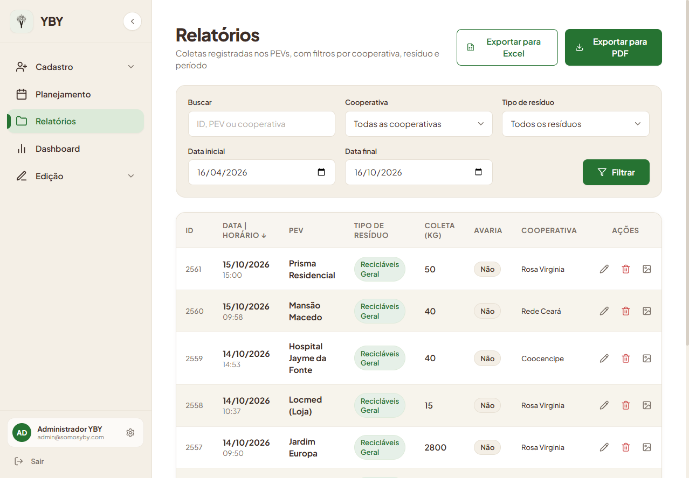
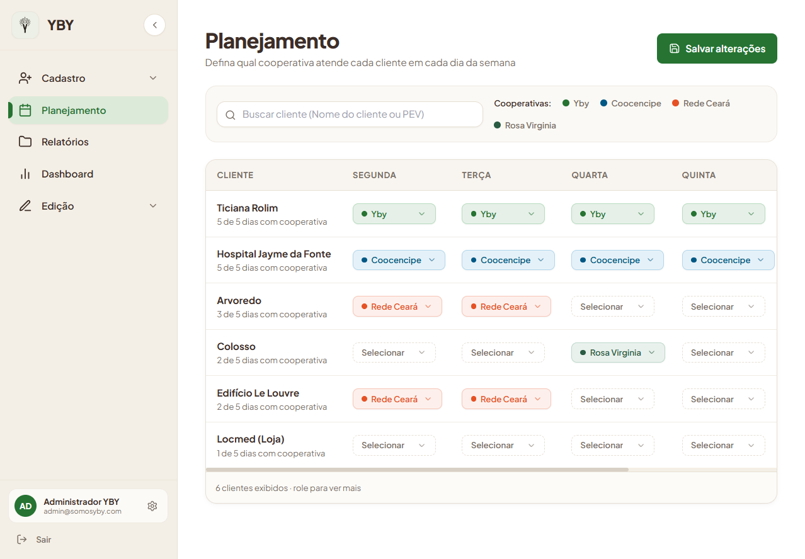
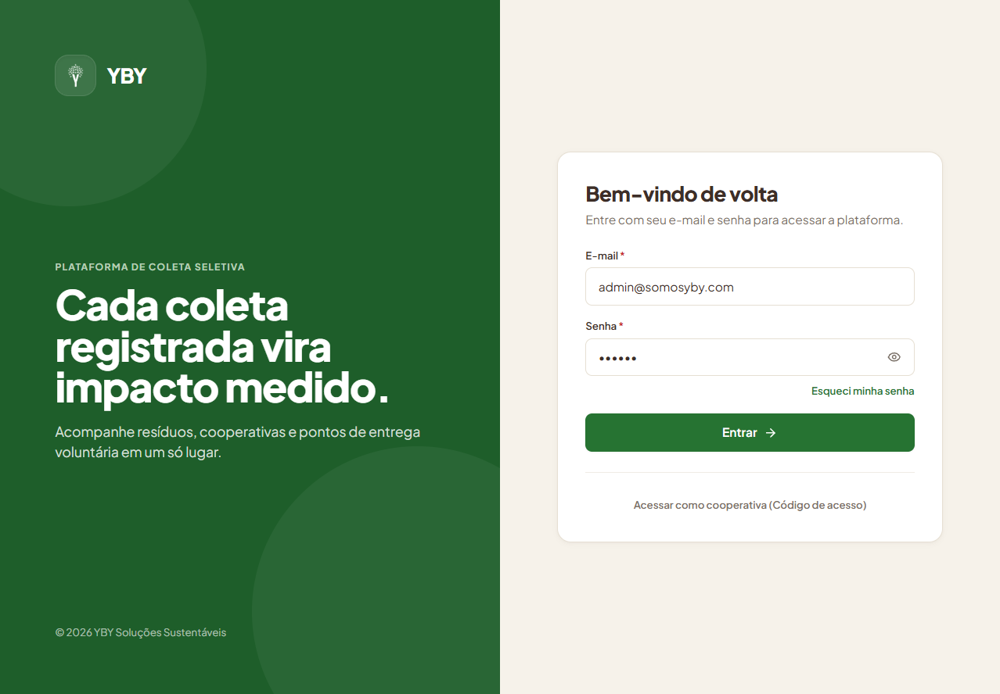

# YBY — Plataforma de Gestão de Resíduos e Coleta Seletiva

[](https://react.dev/)
[](https://vitejs.dev/)
[](https://tailwindcss.com/)
[](https://recharts.org/)
[](LICENSE)

Aplicação Web e Mobile desenvolvida para a **YBY Soluções Sustentáveis**, reformulando e modernizando a experiência de ponta a ponta: desde a Landing Page institucional até o ecossistema operacional de agendamento de coletas, relatórios de impacto socioambiental ESG e inteligência de dados para cooperativas, PEVs e gestores.

---

## Demonstração Online e Repositório

* **Deploy de Produção na Vercel:** [https://yby-web.vercel.app](https://yby-web.vercel.app)
* **Repositório no GitHub:** [https://github.com/ACrush14/yby-web](https://github.com/ACrush14/yby-web)
* **Design System e Protótipo no Figma:** [Protótipo YBY — Figma](https://www.figma.com/proto/smcM50NPk6mbS9j5uzONPP/Projeto-YBY?node-id=2-206&scaling=min-zoom&starting-point-node-id=2%3A206)

---

## Demonstração Visual das Telas

### 1. Dashboard de Indicadores Ambientais (`/dashboard`)
Visualização analítica de impacto ESG em tempo real, com filtros reativos por período ("Semana Atual" vs. "Mês atual"), KPIs primários, secundários e distribuição de resíduos.



---

### 2. Landing Page Institucional (`/`)
Página de apresentação institucional com hero section animada, cards interativos de impacto certificado, etapas de funcionamento e seção de conversão.



---

### 3. Relatórios e Auditoria de Coletas (`/relatorios`)
Listagem filtrável por cooperativa, resíduo e intervalo de datas, com ações diretas de edição, exclusão e visualização de evidências fotográficas.



---

### 4. Planejamento Semanal (`/planejamento`)
Matriz de alocação de cooperativas por PEV para cada dia da semana (Segunda a Sexta), com detecção de status de salvamento e suporte a layout mobile.



---

### 5. Autenticação e Acesso ao Sistema (`/signIn`)
Layout split-screen responsivo com o símbolo oficial YBY, credenciais administrativas e acesso específico para coletores de cooperativas.



---

## Principais Funcionalidades

### 1. Landing Page Institucional (`/`)
* Hero Section com métricas de impacto certificadas.
* 4 Indicadores ESG em tempo real (Energia, Água, CO₂ evitado e Árvores) com micro-interações de hover.
* Seções "Como funciona", "Para quem", "Funcionalidades da Plataforma" e banner CTA.
* 100% responsiva para celulares, tablets e desktops.

### 2. Jornada Completa de Autenticação (`/signIn`, `/signIn-client`, etc.)
* Layout Split-Screen floresta/creme com o símbolo oficial do YBY.
* Login Administrativo (Admin / Gestor) e Login específico para Cooperativas.
* Fluxo de recuperação de senha em 3 etapas (Esqueceu a senha -> Verifique seu e-mail -> Nova senha).

### 3. Dashboard Ambiental Reativo (`/dashboard`)
* Filtros rápidos em pílula ("Semana Atual" vs. "Mês atual").
* Chaveamento reativo em tempo real:
  * 4 KPIs Primários: Consumo de Energia, Economia de Água, CO₂ evitado e Valor Climático Estimado.
  * 4 KPIs Secundários: Benefício Socioambiental, Petróleo evitado, Árvores poupadas e Espaço em aterro sanitário.
  * Gráficos Dinâmicos: Coleta em peso (Área), Rosca com peso total centralizado e Gráficos de barras para Água e Energia.
* Exportação de Relatório Executivo em PDF e pacote de artes para Instagram Stories.

### 4. Planejamento Semanal (`/planejamento`)
* Visão Desktop: Matriz semanal (Segunda a Sexta) com pílulas coloridas por cooperativa, campo de busca interna e detecção de status "Salvo" / "Não salvo".
* Visão Mobile: Adaptação responsiva para Cards Semanais Interativos por cliente com alvos de toque ergonômicos e barra flutuante inferior de salvamento em lote.

### 5. Relatórios e Auditoria de Coletas (`/relatorios`)
* Tabela zebra com paginação e busca combinada.
* Modais com o novo Design System:
  * Modal de Edição de Coleta com recálculo automático de peso e justificativa obrigatória.
  * Modal de Confirmação de Exclusão.
  * Modal de Galeria de Evidências Fotográficas com fotos dos coletores e status de avaria.
* Exportação para planilhas Excel (.xlsx) e relatórios formatados em PDF.

### 6. Cadastros e Edições Unificados (`/cadastro` e `/edicao`)
* Abas em pílula (Cliente, Cooperativa, Gestor).
* Busca automática de endereço por CEP integrada com a API do ViaCEP.
* Sincronização automática com a Sidebar e parâmetros de URL (?tab=...).
* Empty State com busca na tela de edição antes de selecionar o registro.

### 7. Ponto de Coleta Mobile (`/ponto-coleta`)
* Rota dedicada e otimizada para cooperativas em campo com alto contraste para luz solar.
* Lista de PEVs do dia, calculadora de densidade (Litros -> Kg) e upload de evidências fotográficas.

---

## Padrões de Engenharia (SOLID e GRASP)

O projeto foi arquitetado em JavaScript puro (ES6+) seguindo rigorosamente os padrões de Clean Frontend:

* **Separação Estrita entre View e Lógica:** Os componentes .jsx são puramente visuais e declarativos. Toda regra de cálculo fica na camada de Domínio (`src/domain/`) e toda orquestração de estado fica em Controller Hooks (`use...Controller.js`).
* **SOLID:**
  * **SRP (Single Responsibility Principle):** Arquivos enxutos (< 150-200 linhas) com responsabilidade única e coesa.
  * **OCP (Open/Closed Principle):** Calculadora de densidade (`wasteCalculator.js`) aberta para novos resíduos através de mapa de configuração sem alterar código legado.
  * **DIP (Dependency Inversion Principle):** Telas consom interfaces de repositórios desacopladas de APIs externas.
* **GRASP:** Aplicação de Information Expert, Controller, Low Coupling e High Cohesion.
* **JSDoc Completo:** Tipagem e autocomplete para desenvolvedores sem necessidade de compilação TypeScript adicional.

---

## Tecnologias Utilizadas

* **Framework:** [React 18](https://react.dev/) + [Vite 6](https://vitejs.dev/)
* **Roteamento:** [React Router DOM v6](https://reactrouter.com/)
* **Estilização:** [Tailwind CSS 3](https://tailwindcss.com/)
* **Gráficos:** [Recharts](https://recharts.org/)
* **Ícones:** [Lucide React](https://lucide.dev/)
* **Notificações:** [Sonner](https://sonner.emilkowal.ski/)
* **Deploy e CI/CD:** [Vercel](https://vercel.com/)

---

## Como Rodar o Projeto Localmente

### Pré-requisitos
* Node.js 18+ instalado
* Git instalado

### Passo a Passo

```bash
# 1. Clonar o repositório
git clone https://github.com/ACrush14/yby-web.git
cd yby-web

# 2. Instalar dependências
npm install

# 3. Iniciar o servidor de desenvolvimento
npm run dev

# 4. Acessar a aplicação
http://localhost:3000
```

### Build de Produção

```bash
npm run build
npm run preview
```

---

## Estrutura de Pastas

```
yby-web/
├── public/                 # Favicon e imagens do símbolo oficial YBY
├── src/
│   ├── app/                # AppShell e Router
│   ├── domain/             # Cálculos, constantes e regras de negócio puras (SOLID)
│   ├── features/           # Módulos verticais por funcionalidade
│   │   ├── auth/           # Login, recuperação e verificação
│   │   ├── cadastro/       # Cadastros unificados (Cliente, Cooperativa, Gestor)
│   │   ├── dashboard/      # Indicadores analíticos, KPIs e gráficos
│   │   ├── edicao/         # Edições cadastrais em abas
│   │   ├── landing/        # Landing page institucional
│   │   ├── planejamento/   # Escala semanal cooperativas x PEVs
│   │   ├── ponto-coleta/   # Visão mobile de campo para cooperativas
│   │   └── relatorios/     # Tabela de coletas, modais e auditoria
│   ├── services/           # Repositórios (API e Mock híbrido)
│   ├── shared/             # Layouts (Sidebar, Header), Componentes UI e Gráficos
│   └── styles/             # Tokens do Design System e CSS global
├── docs/                   # Documentação arquitetural profunda e prints das telas
│   └── screenshots/        # Capturas reais das interfaces em produção
├── PLANEJAMENTO.md         # Planejamento estratégico geral
├── TODO.md                 # Backlog e checklists do Painel Administrativo
└── vercel.json             # Configuração de rotas para deploy na Vercel
```

---

## Licença

Este projeto é desenvolvido para fins educacionais, de portfólio e evolução tecnológica para a **YBY Soluções Sustentáveis**, sob licença MIT.
