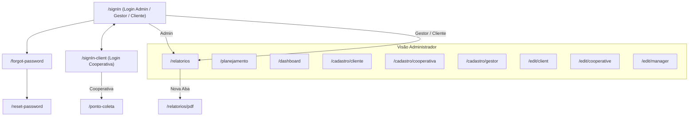

# 02 — Mapeamento Completo das Telas (Sistema Atual)

Este documento descreve detalhadamente todas as telas, componentes, filtros, tabelas, botões e modais existentes na versão atual da plataforma (`https://somosyby.com`), servindo como base funcional para garantir que nenhuma funcionalidade seja perdida na reformulação.

---

## 🧭 Visão Geral do Fluxo de Navegação

---

## 1. Telas de Autenticação

### 1.1. Login Principal (`/signIn`)
* **Público:** Administradores, Gestores e Clientes (PEVs).
* **Elementos Visuais:**
  * Card centralizado sobre fundo bege claro (`rgba(221, 195, 147, 0.2)`).
  * Logo da YBY no topo + título `"Conecte-se à YBY"`.
* **Campos e Botões:**
  * `Endereço de e-mail` (Input texto/email, obrigatório).
  * `Senha` (Input password, obrigatório).
  * Link `"Esqueci minha senha"` -> redireciona para `/forgot-password`.
  * Botão primário `"Entrar"` (verde `#15853B`).
  * Link inferior `"Acessar como cooperativa"` -> redireciona para `/signIn-client`.
* **Comportamento:**
  * Autentica em `/auth/local`, busca dados completos do usuário em `/users/me` (incluindo `role`, `clients` e `manager.clients`), salva no `localStorage ("usuario")` e redireciona para `/relatorios`.

### 1.2. Login da Cooperativa (`/signIn-client`)
* **Público:** Equipes de coleta / Cooperativas.
* **Campos e Botões:**
  * `Código de acesso` (Input texto, obrigatório).
  * Link `"Ir para login do cliente."` -> volta para `/signIn`.
  * Botão `"Entrar"`.
* **Comportamento:**
  * Concatena automaticamente `${codigo}@coop.com` como identificador e usa o próprio código como senha em `/auth/local`.
  * Em caso de sucesso, redireciona para `/ponto-coleta`.

### 1.3. Recuperar Senha (`/forgot-password`)
* **Campos e Botões:**
  * `Digite seu e-mail` (Input email, obrigatório).
  * Botão `"Enviar link de recuperação"`.
* **Modal de Sucesso:**
  * Exibe diálogo `"Recuperação Solicitada!"` informando que o link foi enviado para o e-mail, com botão `"Ir para a tela de Login"`.

### 1.4. Redefinir Senha (`/reset-password?code=...`)
* **Campos e Botões:**
  * `Nova senha` (mínimo 6 dígitos).
  * `Confirmar senha` (deve coincidir com a nova senha).
  * Botão `"Redefinir senha"`.
* **Comportamento:**
  * Envia o parâmetro `code` da URL junto com a nova senha e redireciona para `/signIn` exibindo um alerta verde (Snackbar) no topo: `"Sua senha foi redefinida com sucesso! Faça login com a nova senha."`.

---

## 2. Layout Base e Menu Lateral (Sidebar / Drawer)

* **Largura fixa:** `240px` no Desktop (Drawer permanente) e Menu Hamburguer retrátil no Mobile (`xs`).
* **Topo:** Logo YBY (`100x100`).
* **Itens do Menu (variam conforme o perfil):**
  * **Se Admin (`isAdmin`):**
    * `Cadastro` (Expansível `v`): `Clientes`, `Cooperativas`, `Gestor`
    * `Planejamento`
    * `Relatórios`
    * `Dashboard`
    * `Edição` (Expansível `v`): `Clientes`, `Cooperativas`, `Gestores`
  * **Se Cliente (`client_id`) ou Gestor (`isManager`):**
    * `Relatórios`
    * `Dashboard`
  * **Se Cooperativa (`cooperative_id`):**
    * `PEVs` (`/ponto-coleta`)
* **Rodapé do Menu:** Botão `"Sair"` (limpa `localStorage` e redireciona para `/signIn`).

---

## 3. Tela de Relatórios (`/relatorios`)

É a tela principal de operação e auditoria das coletas realizadas.

### 3.1. Barra de Filtros Superior
* **`Buscar`** (Input texto, `300px`): Filtra pelo nome do PEV (`social_name`). *(Oculto quando logado como Cliente)*.
* **`Cooperativa`** (Select dropdown, `300px`): Opção `"Todas"` + lista de cooperativas cadastradas. *(Oculto quando logado como Cliente)*.
* **`Tipo de Resíduos`** (Input texto, `300px`): Filtra pelo nome do resíduo.
* **`Data Inicial`** (Input date): Padrão 6 meses atrás.
* **`Data Final`** (Input date): Padrão data de hoje.
* **Botão `FILTRAR`** (Outlined com ícone de lupa): Aplica os filtros selecionados na listagem.

### 3.2. Botões de Exportação
* **`Exportar para PDF`** (Botão verde): Abre `/relatorios/pdf?...` em nova aba passando todos os filtros ativos na query string.
  * O PDF gerado contém cabeçalho com logo YBY, tabela completa de coletas e resumo final (`Peso Total das Coletas (Kg)`, `Total de Coletas`, `Total de Avarias`, `Total de Resíduos` e `Data de Geração`).
* **`Exportar para Excel`** (Botão verde): Faz download imediato do arquivo `relatorio_coleta.xlsx`.
  * Cria uma planilha com a primeira aba **`"Resumo"`** (todas as coletas filtradas + soma do peso total no final) e **cria automaticamente abas adicionais separadas para cada Tipo de Resíduo** encontrado no período (ex: aba `"Plástico"`, aba `"Papel"`, aba `"Recicláveis Geral"`), cada uma com seu próprio somatório de peso em Kg.

### 3.3. Tabela de Coletas (Virtualizada com Scroll Infinito)
* Carrega lotes de **100 registros por página** conforme o usuário rola a tabela para baixo (`react-virtuoso` + `RxJS`).
* **Colunas:**
  1. `ID` (ID numérico da coleta)
  2. `Data | Horário` (Formato `dd/MM/yyyy | HH:mm`, **clicável para ordenar asc/desc**)
  3. `PEV` (Razão Social do cliente)
  4. `Tipo de Resíduos` (Lista de resíduos separados por vírgula)
  5. `Coleta (Kg)` (Peso total em Kg)
  6. `Avaria` (`"Sim"` se houver foto de avaria vinculada, ou `"Não"`)
  7. `Cooperativa` (Nome da cooperativa que realizou a coleta)
  8. `Ações` (Ícones de ação no canto direito)
* **Rodapé fixo da tabela:** Exibe `"100 de 469 — Role para baixo para mais"` (ou `"Todos os dados carregados"`).

### 3.4. Modais de Ação na Tabela de Relatórios
1. **Modal "Editar registro do PEV" (Ícone de Lápis — exclusivo Admin):**
   * **Se a coleta possui múltiplos itens (`items`):**
     * Mostra um badge `"X/Y com foto"`.
     * Lista cada item (`Item 1 — Resíduo`) com seu `Peso atual (kg)`, tags de `Quantidade original (kg ou L)` e `Total em litros`, e um campo editável **`Peso corrigido em kg`**.
     * Exibe card verde com o **`Total recalculado da coleta (kg)`** em tempo real.
     * Lista o status das imagens dos coletores por item.
   * **Se a coleta é do modelo antigo (sem `items`):**
     * Multi-select `Tipo de residuos` (`Papel`, `Plástico`, `Metal`, `Vidro`, `Orgânicos`, `Recicláveis Geral`, `Óleo`).
     * Input `Coleta em kg`.
     * Opção de marcar para remover a `Imagem do coletor` (ícone lixeira que risca o texto).
   * **Campos comuns a todas as coletas:**
     * Seção `AVARIA`: Mostra se há imagem de avaria e permite removê-la clicando no ícone de lixeira.
     * `Data da Coleta` (Input date) e `Horário` (Input time).
     * `Justificativa da edição` (`Motivo da edição` — textarea multiline obrigatório).
     * Botões `"Cancelar"` e `"Editar"`.
2. **Modal de Exclusão (Ícone de Lixeira — exclusivo Admin):**
   * Pergunta: `"Tem certeza que deseja excluir o PEV do relatório? Essa ação não poderá ser desfeita."`
   * Botões `"Cancelar"` e `"Sim"` (vermelho).
3. **Modal "Registro fotográfico da coleta" (Ícone de Foto — visível para Admin, Gestor e Cliente):**
   * Exibe metadados no topo: **`Registrado por`** (Nome da Cooperativa) e **`Data da coleta`**.
   * Exibe os cards de cada resíduo coletado com sua **foto do coletor**, peso em Kg e volume original.
   * Exibe também a **foto de avaria** (quando houver).

---

## 4. Tela de Planejamento (`/planejamento`)

* **Público:** Exclusivo Administrador.
* **Cabeçalho:** Título `"Planejamento Geral"` + Input `"Pesquisar"` (`Pesquisar por título`, `300px`) que filtra os clientes/PEVs em tempo real e ordena alfabeticamente.
* **Lista de Cards de PEV:**
  * Cada PEV possui um card com borda verde (`#15853B`), exibindo o **Nome do PEV** à esquerda e o botão **`SALVAR`** à direita.
  * Abaixo da linha divisória, há **5 colunas correspondentes aos dias úteis** (`Segunda`, `Terça`, `Quarta`, `Quinta`, `Sexta`):
    * Cada coluna tem um **Checkbox** com o nome do dia.
    * Abaixo do checkbox, um **Select `"Cooperativa"`** (habilitado apenas quando o checkbox daquele dia está marcado) contendo todas as cooperativas cadastradas.
  * Ao clicar em **`SALVAR`**, envia `PUT /plannings/:documentId` atualizando as cooperativas de segunda a sexta daquele PEV.

---

## 5. Tela de Dashboard (`/dashboard`)

Apresenta os indicadores estratégicos de impacto ambiental (ESG) e gráficos mensais.

### 5.1. Cabeçalho e Exportações
* Título `"Dashboard"` à esquerda.
* Dois botões de ação à direita:
  1. **`Baixar artes para Stories`** (Botão outlined verde):
     * Renderiza em background 4 telas verticais (`1080x1920px`) com design editorial (fontes *Spectral* e *Hanken Grotesk*, temas verde-floresta escuro e bege claro):
       * `story-01-capa.png`: Capa com peso total de resíduos coletados + 3 cards (Água, CO₂e, Árvores).
       * `story-02-indicadores.png`: Os 4 indicadores de impacto em destaque + leitura do período.
       * `story-03-residuos.png`: Barras horizontais de participação percentual por tipo de resíduo.
       * `story-04-impacto.png`: Card de fechamento institucional com resumo de impacto climático.
     * Compacta as 4 imagens em um arquivo **`yby-impacto-stories.zip`** e inicia o download.
  2. **`Baixar relatório PDF`** (Botão primário verde):
     * Gera e baixa o arquivo **`dashboard-report.pdf`** com o Relatório Executivo de Impacto Ambiental (tabelas mensais de Peso, Água, Energia, Petróleo e Árvores + indicadores consolidados).

### 5.2. Barra de Filtros do Dashboard
* **`Selecionar PEV`** (`230px`):
  * Para **Admin**: Multi-select com todos os clientes cadastrados + botão `X` para limpar seleção (quando vazio, mostra dados gerais da YBY).
  * Para **Gestor**: Multi-select apenas com os clientes da sua carteira.
  * Para **Cliente**: Select somente leitura travado no próprio PEV (`"PEV selecionado"`).
* **`Tipo de resíduo`** (`230px`): Select carregado de `/wastes` + botão `X` para limpar.
* **`Data inicial`** e **`Data final`** + link rápido **`"Mês atual"`** (que preenche do dia 1º do mês atual até hoje).

### 5.3. Cards de Indicadores (KPIs Ambientais)
* Exibe cartões de resumo com os totais consolidados no período:
  * **Peso Coletado (kg)**
  * **Economia de Água (L)**
  * **Consumo/Economia de Energia (MWh)**
  * **CO₂e Evitado (kg)**
  * **Árvores Poupadas**
  * **Petróleo Economizado (L)**
  * **Espaço em Aterro Sanitário**
  * **Valor Recuperado (R$)**

### 5.4. Grade de Gráficos (`Recharts`)
Cards com fundo bege (`#FAF1E8`):
1. **Coleta em peso (kg) por mês:** Gráfico de linha (`LineChart`).
2. **Tipo de resíduo coletado no período (%):** Gráfico de rosca (`PieChart` com `innerRadius` e legenda percentual por cor).
3. **Comparativo Ambiental / Árvores e Petróleo:** Card visual complementar ao lado do gráfico de rosca.
4. **Economia de Água (L) por mês:** Gráfico de linha azul (`LineChart`).
5. **Consumo de Energia (MWh) por mês:** Gráfico de barras laranja (`BarChart`).

---

## 6. Telas de Cadastro (`/cadastro/*`)

Exclusivas para **Administrador**. Possuem título `"Cadastro"` e um seletor estilo *Segmented Control* com 3 abas: **`CLIENTE` | `COOPERATIVA` | `GESTOR`**.

### 6.1. Aba `CLIENTE` (`/cadastro/cliente`)
* **Seção "Dados básicos":**
  * `Razão Social` (Texto, obrigatório)
  * `Número de CNPJ` (Máscara `00.000.000/0000-00`, obrigatório)
  * `Nome do Responsável` (Texto, obrigatório)
  * `E-mail` (E-mail válido, verifica duplicidade na API antes de criar)
  * `Telefone` (Máscara `(00) 0000-0000`, obrigatório)
  * `Usuário` (Nome de usuário para login, obrigatório)
  * `Senha` (Mínimo 6 dígitos, obrigatório)
* **Seção "Endereço":**
  * `CEP` (Máscara `00000-000`, obrigatório)
  * `Rua` (Texto, obrigatório)
  * `Número` (Numérico, obrigatório)
  * `Bairro` (Texto, obrigatório)
  * `Estado` (Texto, obrigatório)
  * `Cidade` (Texto, obrigatório)
* **Botão `"Cadastrar"`:** Cria o cliente e automaticamente inicializa seu PEV/Planejamento.

### 6.2. Aba `COOPERATIVA` (`/cadastro/cooperativa`)
* **Seção "Dados básicos":**
  * `Nome da Cooperativa` (Mínimo 6 caracteres, obrigatório)
  * `Código de acesso` (Mínimo 6 caracteres, apenas letras minúsculas `^[a-z]+$`, possui **ícone de copiar para a área de transferência** no final do input)
  * `Número de colaboradores` (Numérico, mínimo 1, obrigatório)
* **Botão `"Cadastrar"`**.

### 6.3. Aba `GESTOR` (`/cadastro/gestor`)
* **Seção "Dados básicos":**
  * `Usuário` (Mínimo 3 caracteres, obrigatório)
  * `E-mail` (E-mail válido, obrigatório)
  * `Senha` (Mínimo 6 caracteres, obrigatório)
* **Seção "Clientes vinculados":**
  * `Clientes` (Autocomplete multi-seleção carregando todos os clientes em ordem alfabética; obrigatório selecionar pelo menos 1 cliente).
* **Botão `"Cadastrar"`**.

---

## 7. Telas de Edição (`/edit/*`)

Exclusivas para **Administrador**. Possuem título `"Edição"`, o seletor de 3 abas (**`CLIENTE` | `COOPERATIVA` | `GESTOR`**) e um campo **Autocomplete de busca** no topo (`"Selecione um cliente"`, `"Selecione uma cooperativa"` ou `"Selecione um gestor"`).

Ao selecionar um registro no Autocomplete, o formulário correspondente é carregado preenchido:
* **Edição de Cliente (`/edit/client`):**
  * Mesmos campos do cadastro (exceto usuário/senha) + campo adicional **`Clientes`** (Autocomplete múltiplo para vincular sub-clientes/filiais ao cliente principal).
  * Botão `"Editar"`.
* **Edição de Cooperativa (`/edit/cooperative`):**
  * Permite editar `Nome da cooperativa`, `Código de acesso` e `Quantidade de cooperados`.
  * Botão `"Editar"`.
* **Edição de Gestor (`/edit/manager`):**
  * Permite editar `Nome do gestor`, `E-mail`, `Nova senha` (opcional — com texto de ajuda *"Preencha somente para redefinir a senha do gestor"*) e alterar a lista de `Clientes vinculados`.
  * Botão `"Editar"`.

---

## 8. Tela de Ponto de Coleta — Visão da Cooperativa (`/ponto-coleta`)

Interface voltada para uso em celulares pelas equipes de coleta das cooperativas. Possui um seletor superior em formato de pílula arredondada com 2 abas: **`PEVs` | `Coleta`**.

### 8.1. Aba `PEVs`
* **Input `Pesquisar`** (`Pesquisar por título`): Filtra a lista de PEVs atribuídos àquela cooperativa.
* **Ordenação Inteligente:** PEVs agendados para o dia da semana atual aparecem primeiro na lista.
* **Cards de PEV (`#F8F3E9`):**
  * Nome do condomínio/empresa (`social_name`).
  * Endereço (`Rua, Número`).
  * Ícone de calendário + dias da semana planejados para aquela cooperativa (se o dia coincidir com hoje, exibe **`HOJE`** em destaque).
  * **Botão de ação:**
    * Exibe **`"Coletar aqui"`** (habilitado apenas se hoje for um dia planejado de coleta daquele PEV; ao clicar, muda automaticamente para a aba `Coleta` já com o PEV selecionado).
    * Se já tiver sido coletado hoje no aparelho, exibe **`"Já foi coletado"`** (desabilitado).

### 8.2. Aba `Coleta`
* **Captura de GPS:** Ao abrir a tela, solicita `navigator.geolocation.getCurrentPosition` em background para anexar `latitude` e `longitude` ao registro da coleta.
* **Seção "Sobre a coleta":**
  * Select **`Ponto de coleta`**: Lista os PEVs da cooperativa no formato `"Razão Social - Rua, Número - Bairro"`.
* **Seção "Resíduos desta coleta" (Lista Dinâmica de Itens):**
  * Inicia com `Item 1` e possui botão **`"Adicionar outro resíduo"`** para incluir quantos itens forem necessários (com botão de lixeira para remover itens extras).
  * Dentro de cada card de **Item**:
    1. Select **`Tipo de resíduo`** (`Plástico`, `Papel`, `Metal`, `Vidro`, `Recicláveis Geral`, `Orgânicos`, `Óleo`).
    2. Input **`Quantidade`** + Radio Group de unidade (**`Kg`** ou **`Litros`**).
    3. **Calculadora de `"Coletores cheios"`** (aparece quando a unidade **`Litros`** é selecionada):
       * Botão `"Selecionar coletores"` abre um modal onde o coletor informa quantos recipientes/contentores cheios coletou, calculando o volume total em Litros automaticamente (que depois será convertido para Kg pela densidade do resíduo).
    4. **Upload obrigatório `"Foto do coletor deste resíduo"`**:
       * Área tracejada verde `"Toque para inserir foto do coletor"` (abre a câmera traseira no celular via `capture="environment"`), com preview da foto e botão de excluir/trocar.
* **Seção "Avaria geral da coleta":**
  * Pergunta: *"A coleta possui alguma avaria ou problema no coletor/PEV?"*
  * Radio Group: **`Não`** | **`Sim`**.
  * Se **`Sim`**, exibe área de upload obrigatório **`"Foto da avaria"`** com preview.
* **Botão `"Registrar coleta"`:**
  * Faz a compressão das imagens em Canvas (`1280x1280`, JPEG `72%`), envia para `/upload`, converte volumes em Litros para Kg conforme a densidade de cada resíduo e salva a coleta completa via `POST /collections/with-items`.
