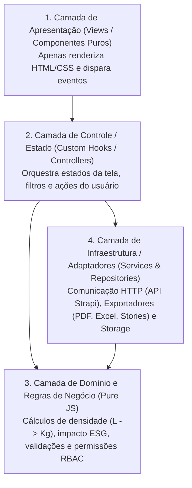

# 05 — Padrões de Engenharia de Software: SOLID, GRASP e Clean Architecture em JavaScript

Este documento define a arquitetura de software e os princípios de projeto (**SOLID**, **GRASP**, **Clean Code** e **Arquitetura Modular por Features**) que serão aplicados na construção da nova aplicação web **YBY** em **JavaScript (ES6+)**.

O objetivo principal desta arquitetura é garantir um **código limpo, previsível, desacoplado e extremamente fácil de ler e dar manutenção**, evitando arquivos gigantes que misturam interface visual, chamadas de API e regras de negócio.

---

## 🏗️ 1. Visão Geral da Arquitetura em Camadas (Clean Frontend)

Mesmo sendo uma aplicação Web em JavaScript (React + Vite), o código será rigorosamente dividido em **4 camadas independentes**, onde cada camada tem uma responsabilidade única:



### Regra de Ouro para Leitura de Código:
* **Componentes Visuais (`.jsx`) NUNCA fazem `fetch`/`axios` diretamente** e **NUNCA contêm fórmulas matemáticas ou regras de negócio**.
* **Regras de Domínio (`.js`) são funções puras em JavaScript**, sem dependência de React, podendo ser lidas e testadas isoladamente.
* **Nenhum arquivo deve ultrapassar ~150 a 200 linhas.** Se crescer além disso, deve ser dividido seguindo o princípio de Responsabilidade Única (SRP).

---

## 🧱 2. Aplicação Prática dos Princípios SOLID no Projeto YBY

### **S — Single Responsibility Principle (Princípio da Responsabilidade Única)**
> *"Um módulo, classe ou função deve ter um, e apenas um, motivo para mudar."*

* **Como era no sistema antigo (Problema):** A tela de Relatórios tinha quase 1.000 linhas misturando tabela virtualizada, filtros, chamadas à API, geração de Excel, modais de edição e cálculo de peso.
* **Como será no novo YBY (Solução):**
  1. `RelatoriosPage.jsx`: Apenas estrutura o layout da página.
  2. `RelatoriosFilterBar.jsx`: Apenas renderiza os inputs de filtro e o botão `Filtrar`.
  3. `RelatoriosTable.jsx`: Apenas exibe as linhas de dados e emite eventos (`onEdit`, `onDelete`, `onViewPhotos`).
  4. `useRelatoriosController.js`: Gerencia o estado dos filtros, paginação e chama os serviços.
  5. `collectionRepository.js`: Faz apenas as requisições HTTP para `/collections`.
  6. `excelExporterService.js`: Faz apenas a conversão dos dados em planilha `.xlsx`.

---

### **O — Open/Closed Principle (Princípio Aberto/Fechado)**
> *"Entidades de software devem estar abertas para extensão, mas fechadas para modificação."*

* **Aplicação no YBY:**
  * **1. Tabela de Densidades e Impacto Ambiental (`wasteCalculator.js`):** Em vez de usar vários `if/else` ou `switch` espalhados pelo código para converter Litros em Kg (`Plástico = 1.41`, `Papel = 0.80`, etc.), usamos um **Mapa de Configuração / Strategy (`WASTE_DENSITY_MAP`)**. Se a YBY adicionar um novo tipo de resíduo no futuro (ex: `Eletrônicos`), basta adicionar uma linha no mapa sem modificar a lógica da calculadora.
  * **2. Exportadores de Relatórios (`exporters/`):** Criamos uma interface padrão `exportData(collections, options)` com estratégias independentes (`PdfExporter`, `ExcelExporter`, `StoriesZipExporter`). Adicionar um `CsvExporter` no futuro não altera uma única linha das telas.

---

### **L — Liskov Substitution Principle (Princípio da Substituição de Liskov)**
> *"Subtipos ou implementações alternativas devem poder substituir seus tipos base sem quebrar o funcionamento do programa."*

* **Aplicação no YBY:**
  * **Repositórios de Dados (`ApiRepository` vs `MockRepository`):** Tanto o repositório conectado à API real (`https://back.somosyby.com/api`) quanto o repositório de dados simulados/mock (para desenvolvimento rápido e testes locais sem afetar a produção) retornam exatamente o mesmo formato padronizado de objetos JavaScript (DTOs/Modelos normalizados). A tela não sabe nem se importa se os dados vieram do Strapi ou do Mock local.
  * **Componentes Base do Design System (`Button`, `Badge`, `InputField`, `SelectField`):** Todos aceitam contratos padronizados de propriedades (`variant`, `size`, `disabled`, `onChange`), permitindo trocar um input de texto por um select sem quebrar o layout do formulário.

---

### **I — Interface Segregation Principle (Princípio da Segregação de Interface)**
> *"Nenhum cliente (ou componente) deve ser forçado a depender de dados ou métodos que não utiliza."*

* **Aplicação no YBY:**
  * **Props Enxutas nos Componentes:** Em vez de passar o objeto inteiro `user` ou a resposta bruta inteira do Strapi (`collection.attributes.client.data.attributes...`) para um componente visual como `<KpiCard />` ou `<PlanningRow />`, passamos apenas as propriedades exatas que ele precisa exibir:
    ```javascript
    // ✅ Correto (ISP): O componente recebe apenas o que usa
    <KpiCard
      title="Consumo de energia"
      value="266.049,94 MWh"
      icon="bolt"
      accentColor="orange"
    />
    ```
  * **Hooks Segregados:** Separamos `useAuthSession()` (apenas dados do usuário logado) de `usePermissions()` (apenas flags como `canEditCollection`, `canManagePlanning`), para que componentes simples não re-renderizem desnecessariamente.

---

### **D — Dependency Inversion Principle (Princípio da Inversão de Dependência)**
> *"Módulos de alto nível não devem depender de módulos de baixo nível. Ambos devem depender de abstrações."*

* **Aplicação no YBY:**
  * A camada de domínio e as telas **nunca conhecem detalhes específicos do Strapi** (como `filters[client][id][$eq]` ou `documentId`).
  * Criamos um **Adaptador / Normalizador (`strapiAdapter.js`)** na camada de infraestrutura. Se amanhã o backend da YBY mudar do Strapi para Node/Prisma, Supabase ou Firebase, **apenas a pasta `src/services/api/` muda** — 100% das telas e regras de negócio continuam funcionando intactas.

---

## 🎯 3. Aplicação Prática dos Padrões GRASP no Projeto YBY

Os 9 padrões **GRASP** (*General Responsibility Assignment Software Patterns*) guiam **onde colocar cada responsabilidade** no código JavaScript:

| Padrão GRASP | Pergunta que ele responde | Como será aplicado no código do YBY |
| :--- | :--- | :--- |
| **1. Information Expert (Especialista na Informação)** | *Quem deve fazer um cálculo ou validação?* -> Quem já possui os dados necessários. | O módulo `planningDomain.js` possui os dados dos 5 dias (`seg` a `sex`) de um cliente, portanto **ele** é o responsável por calcular `"3 de 5 dias com cooperativa"` e se o status da linha é `"Salvo"` ou `"Não salvo"`. |
| **2. Creator (Criador)** | *Quem deve instanciar/montar um objeto complexo?* | O `CollectionFactory.js` é o responsável por montar o payload de uma nova coleta com múltiplos `collection-items` a partir dos dados preenchidos pela cooperativa em campo. |
| **3. Controller (Controlador)** | *Quem recebe os eventos da interface (cliques, submits) e coordena a resposta?* | Cada página possui seu **Controller Hook** (ex: `usePlanejamentoController.js`, `useRelatoriosController.js`). O botão `"Salvar alterações"` apenas chama `controller.handleSaveAll()`, mantendo o arquivo `.jsx` puramente visual. |
| **4. Low Coupling (Baixo Acoplamento)** | *Como evitar que uma mudança quebre várias telas?* | Nenhuma feature importa arquivos internos de outra feature. Tudo o que é compartilhado fica em `src/shared/` ou `src/domain/`. |
| **5. High Cohesion (Alta Coesão)** | *Como manter arquivos focados e fáceis de entender?* | Agrupamento por domínio/feature: tudo que pertence ao **Planejamento Semanal** (tabela, pílula de cooperativa, popover de busca, controller) fica junto dentro de `src/features/planejamento/`. |
| **6. Polymorphism (Polimorfismo)** | *Como lidar com variações de comportamento por perfil (`Admin`, `Gestor`, `Cliente`, `Cooperativa`) sem dezenas de `if/else`?* | Criamos políticas de perfil em `src/domain/permissions/rolePolicies.js`. Cada perfil define suas rotas permitidas, itens da Sidebar e ações visíveis através de um mapa polimórfico limpo. |
| **7. Pure Fabrication (Fabricação Pura)** | *Onde colocar funcionalidades técnicas que não pertencem a nenhuma entidade do domínio?* | Serviços utilitários puros como `excelExporter.js`, `pdfGenerator.js`, `storiesImageGenerator.js` e `imageCompressor.js`. |
| **8. Indirection (Indireção)** | *Como desacoplar a tela da biblioteca externa (ex: Recharts, HTTP client)?* | Criamos componentes wrappers em `src/shared/charts/` (`AreaMetricChart.jsx`, `WasteDonutChart.jsx`, `MonthlyBarChart.jsx`) e um `httpClient.js` centralizado. |
| **9. Protected Variations (Variações Protegidas)** | *Como proteger o sistema contra mudanças na API ou regras de cálculo?* | Contratos de dados (Mappers/DTOs) na fronteira da API e constantes de negócio centralizadas em `src/domain/constants/`. |

---

## 📁 4. Estrutura de Pastas Proposta (JavaScript Modular)

A organização das pastas foi desenhada para que você bata o olho na árvore de arquivos e encontre qualquer tela, regra ou componente em menos de 5 segundos:

```text
src/
├── app/                          # Configuração global da aplicação
│   ├── App.jsx                   # Componente raiz
│   ├── routes.jsx                # Definição de todas as rotas e Guards de autenticação
│   └── providers/                # Contextos globais (Auth, Toast/Notificações, Tema)
│
├── assets/                       # Logos, ícones SVG e ilustrações estáticas
│
├── styles/                       # Design System e Tokens do novo Figma
│   ├── tokens.js                 # Paleta de cores, tipografia, sombras e breakpoints
│   └── global.css                # Reset CSS, variáveis CSS (--color-primary, etc.) e utilitários responsivos
│
├── domain/                       # 🧠 CAMADA DE DOMÍNIO (JavaScript Puro — Zero React)
│   ├── constants/
│   │   ├── wasteTypes.js         # Tipos de resíduos, cores e fatores de densidade (L -> Kg)
│   │   └── cooperativeColors.js  # Cores semânticas das cooperativas (Yby, Coocencipe, Rede Ceará...)
│   ├── calculators/
│   │   ├── wasteWeightCalculator.js  # Conversão L -> Kg e soma de itens da coleta
│   │   └── planningStatusHelper.js   # Cálculo de "X de 5 dias" e detecção de alterações ("Não salvo")
│   ├── permissions/
│   │   └── rolePolicies.js       # Regras RBAC (Admin, Gestor, Cliente/PEV, Cooperativa)
│   └── validators/
│       └── formValidators.js     # Validações de CNPJ, CEP, E-mail, Senha e Justificativa
│
├── services/                     # 🔌 CAMADA DE INFRAESTRUTURA (Pure Fabrication / Indirection)
│   ├── http/
│   │   └── httpClient.js         # Cliente HTTP centralizado com injeção automática de JWT
│   ├── mappers/
│   │   └── strapiMapper.js       # Protected Variations: traduz JSON do Strapi para objetos limpos
│   ├── repositories/
│   │   ├── authRepository.js
│   │   ├── clientRepository.js
│   │   ├── cooperativeRepository.js
│   │   ├── managerRepository.js
│   │   ├── planningRepository.js
│   │   ├── collectionRepository.js
│   │   └── dashboardRepository.js
│   └── exporters/
│       ├── excelExporter.js      # Exportação multi-abas (.xlsx)
│       ├── pdfExporter.js        # Geração de relatórios PDF
│       └── storiesExporter.js    # Geração de artes 1080x1920 (.zip)
│
├── shared/                       # 🧩 COMPONENTES VISUAIS REUTILIZÁVEIS (Design System YBY)
│   ├── layout/
│   │   ├── AppShell.jsx          # Layout autenticado (Sidebar retrátil no Desktop + Drawer no Mobile)
│   │   ├── Sidebar.jsx           # Menu lateral do novo Figma (com botão < de recolher)
│   │   ├── MobileHeader.jsx      # Barra superior para celulares com botão Hamburger
│   │   └── PageHeader.jsx        # Cabeçalho padrão (Título, Subtítulo e Botões de ação à direita)
│   ├── ui/
│   │   ├── Button.jsx            # Botões Solid, Outlined e Ghost nas cores YBY
│   │   ├── InputField.jsx        # Inputs com label, asterisco vermelho e foco verde suave
│   │   ├── SelectField.jsx       # Dropdowns padronizados
│   │   ├── PillTabs.jsx          # Abas em pílula (Cliente | Cooperativa | Gestor)
│   │   ├── Badge.jsx             # Pílulas semânticas (Recicláveis Geral, Avaria: Não, Status Salvo)
│   │   ├── Modal.jsx             # Estrutura base de modal acessível e responsivo
│   │   └── EmptyState.jsx        # Estado vazio ilustrado (ex: lupa "Selecione um cliente")
│   └── charts/
│       ├── AreaMetricChart.jsx   # Gráfico de linha/área preenchida (Coleta em peso por mês)
│       ├── WasteDonutChart.jsx   # Gráfico de rosca com totalizador central ("68,3 mil kg")
│       └── MonthlyBarChart.jsx   # Gráfico de barras verticais (Água e Energia)
│
└── features/                     # 🚀 FUNCIONALIDADES E TELAS (Alta Coesão por Módulo)
    ├── landing/                  # Landing Page Institucional (node-id=2-206)
    │   ├── LandingPage.jsx
    │   └── components/           # HeroSection, ImpactSection, HowItWorksSection, ForWhomSection, FeaturesSection
    ├── auth/                     # Login, Esqueci a Senha, Verifique E-mail, Nova Senha e Login Cooperativa
    │   ├── pages/
    │   ├── components/           # AuthSplitLayout.jsx
    │   └── hooks/                # useAuthController.js
    ├── dashboard/                # Dashboard Ambiental (node-id=40-467)
    │   ├── DashboardPage.jsx
    │   ├── components/           # DashboardFilterBar, PrimaryKpiGrid, SecondaryKpiGrid
    │   └── hooks/                # useDashboardController.js
    ├── planejamento/             # Planejamento em Grade Semanal (node-id=122-1141)
    │   ├── PlanejamentoPage.jsx
    │   ├── components/           # PlanningTable, CooperativePillSelect, CooperativeLegend, MobilePlanningCard
    │   └── hooks/                # usePlanejamentoController.js
    ├── relatorios/               # Relatórios e Auditoria (node-id=42-531)
    │   ├── RelatoriosPage.jsx
    │   ├── components/           # RelatoriosFilterCard, RelatoriosTable, EditCollectionModal, PhotoGalleryModal, DeleteConfirmModal
    │   └── hooks/                # useRelatoriosController.js
    ├── cadastro/                 # Cadastro Unificado em Abas (node-id=44-622)
    │   ├── CadastroPage.jsx
    │   ├── components/           # ClientForm, CooperativeForm, ManagerForm
    │   └── hooks/                # useCadastroController.js
    ├── edicao/                   # Edição Unificada em Abas (node-id=44-1114 / 44-1197)
    │   ├── EdicaoPage.jsx
    │   ├── components/           # EntitySearchSelector, EditClientForm, EditCooperativeForm, EditManagerForm
    │   └── hooks/                # useEdicaoController.js
    └── ponto-coleta/             # Fluxo Mobile de Campo para Cooperativas (/ponto-coleta)
        ├── PontoColetaPage.jsx
        ├── components/           # PevScheduleList, NewCollectionWizard, CollectorVolumeModal
        └── hooks/                # usePontoColetaController.js
```

---

## 📖 5. Convenções de Legibilidade e Documentação no Código

Para garantir que você consiga ler e entender qualquer parte do código rapidamente:
1. **JSDoc em todas as funções de Domínio e Serviços:** Mesmo usando JavaScript puro (sem TypeScript), documentaremos parâmetros e retornos com comentários `/** @param ... @returns ... */` para que o VS Code / Antigravity mostre autocomplete completo ao passar o mouse.
2. **Nomes Descritivos e Sem Abreviações Crípticas:**
   * ❌ Evitar: `const calcW = (q, u, t) => ...`
   * ✅ Usar: `const calculateWeightInKg = (quantity, unit, wasteType) => ...`
3. **Retorno Antecipado (*Early Return* / *Guard Clauses*):** Evitar blocos `if/else` aninhados profundamente.
4. **Separação explícita entre "O que a tela mostra" (`.jsx`) e "Como a tela funciona" (`use...Controller.js`).**
5. **Reatividade Desacoplada nos Controllers (Exemplo do Dashboard):**
   * Em `useDashboardController.js`, o estado dos filtros (`quickFilter`, `startDate`, `endDate`, `pev`, `waste`) aciona reativamente `dashboardRepository.getMetrics(filters)`.
   * A camada de apresentação (`DashboardPage.jsx`, `PrimaryKpiGrid.jsx`, `AreaMetricChart.jsx`) permanece 100% livre de lógica de busca ou chaveamento condicional de dados — ela apenas consome o estado atualizado retornado pelo hook, respeitando o princípio de **Baixo Acoplamento (Low Coupling)** e **Alta Coesão (High Cohesion)**.
6. **Submenus e Parâmetros de URL como Estado Compartilhado:**
   * A navegação da `Sidebar.jsx` repassa parâmetros de consulta (`?tab=cliente|cooperativa|gestor`) que são lidos pelo `useCadastroController.js` e `useEdicaoController.js` via `useSearchParams`, permitindo sincronização perfeita entre menu lateral e abas sem criar dependências circulares entre componentes.
